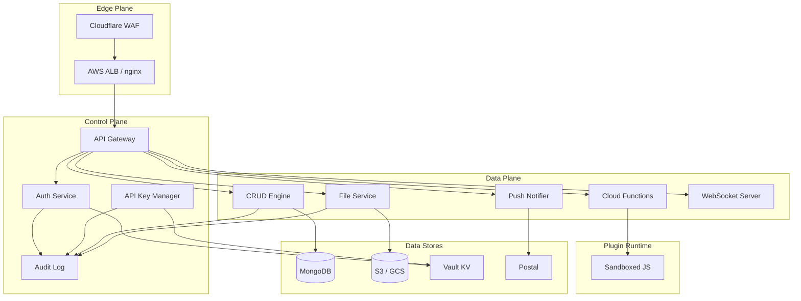
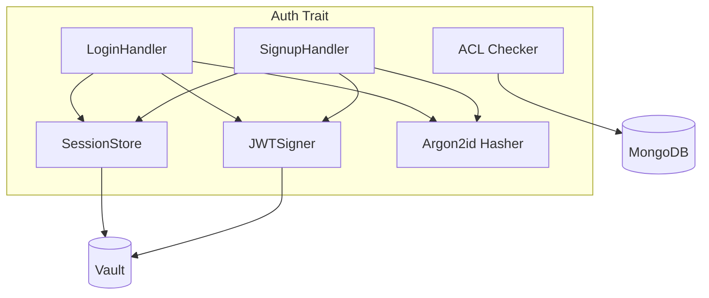
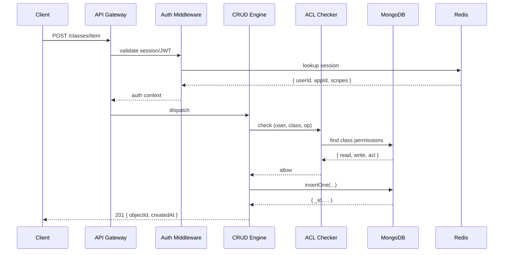
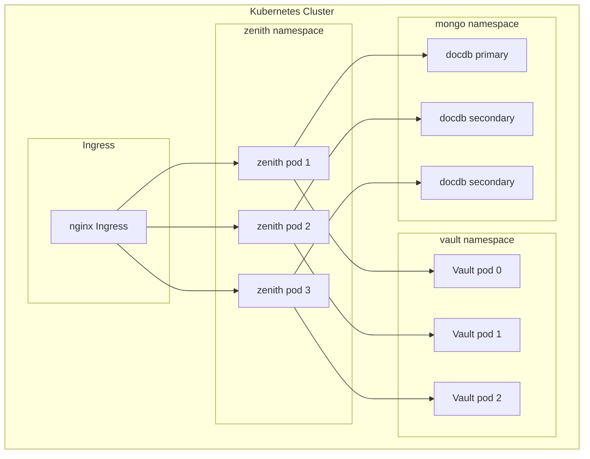
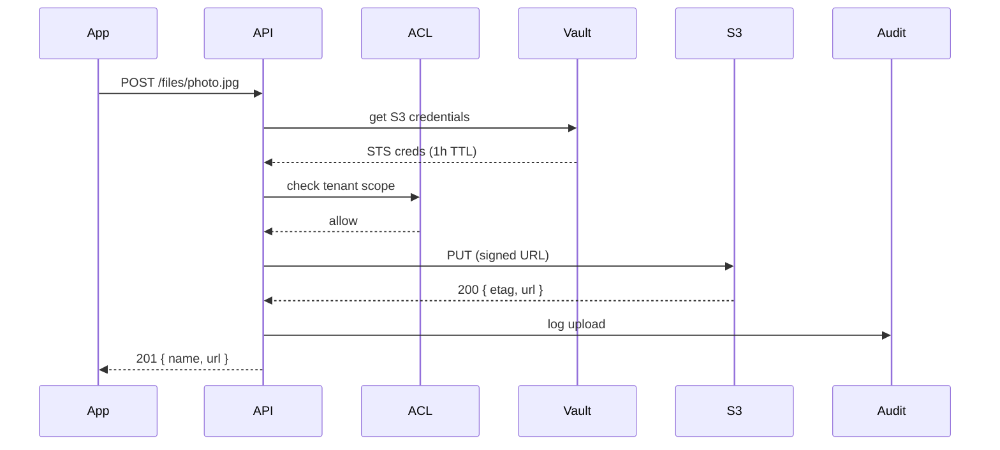
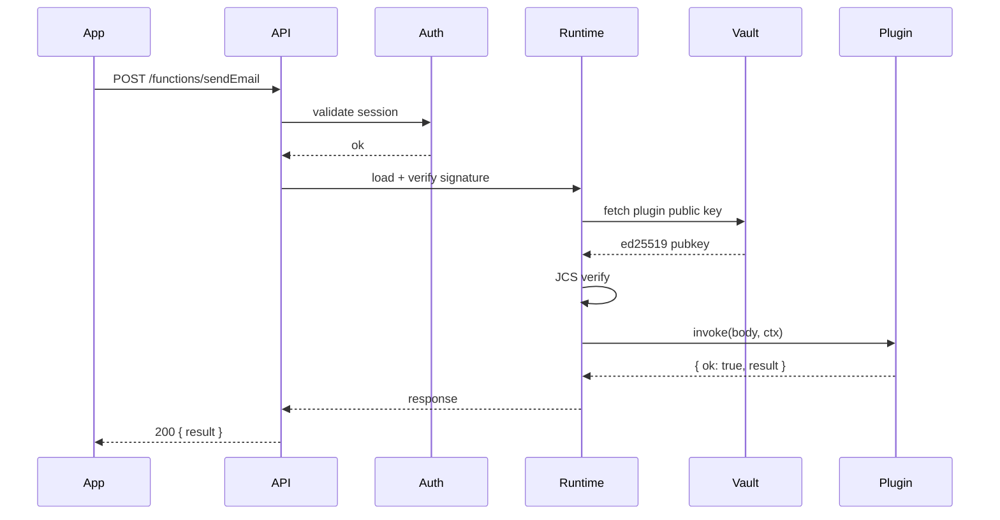

# Zenith — C4 Architecture Model

> ⚠️ **Estado (2026-11-10): diseño aspiracional.** Describe un servicio alojado (dominios `zenith.io`, regiones, planes, certificaciones, equipos de guardia) que no existe. No es una guía de uso; lo vigente está en [docs/index.md](../index.md).

> **Notation:** C4 model (Context, Containers, Components, Code)
> **Format:** Mermaid (renders natively in GitHub, GitLab, Notion, Obsidian)

## Level 1 — System Context

```mermaid
graph LR
    User[End User<br/>Web/Mobile App]
    Dev[Developer]
    Admin[Customer Admin]
    SRE[Zenith SRE]
    
    User -->|HTTPS| Zenith
    Dev -->|HTTPS + SDK| Zenith
    Admin -->|HTTPS + OIDC| Zenith
    SRE -->|kubectl + Grafana| Zenith
    
    subgraph Zenith
        Zenith[Zenith BaaS<br/>BaaS Platform]
    end
    
    Zenith -->|CRUD/Query| MongoDB[(MongoDB)]
    Zenith -->|Files| S3[(S3 / GCS)]
    Zenith -->|Secrets| Vault[HashiCorp Vault]
    Zenith -->|Email| Postal[Postal SMTP]
    Zenith -->|Auth| Keycloak[Keycloak / Zitadel]
```

## Level 2 — Container



## Level 3 — Component (Auth trait)



## Level 4 — Code (CRUD request flow)



## Deployment topology



## Data flow — file upload



## Data flow — cloud function


