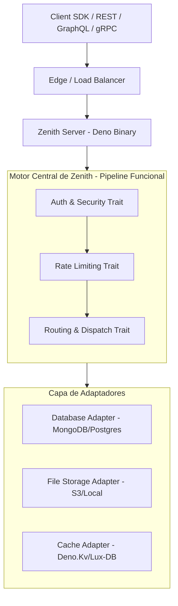

# 03 — Arquitectura del Núcleo de Zenith (Core Architecture)

> **Fase**: Diseño Arquitectónico y SecOps (Fortune 500 Grade)
> **Autor**: Equipo Zenith — @zuccadev-labs
> **Fecha**: 2026-06-05
> **Estado**: Final v2.0
> **Prerrequisito**: [02_barrits_integration_design.md](./02_barrits_integration_design.md)

---

## 1. Visión General del Sistema (High-Level Design)

Zenith es un BaaS (Backend-as-a-Service) inspirado en la simplicidad de Parse Server y el escalado de plataformas como Back4App y Supabase, pero implementado nativamente para la nube moderna bajo el ecosistema de **Deno** y orquestado por **Barrits**.

Ha evolucionado para ser un **Motor Orquestador de Infraestructura** enfocado en el modelo B2B y Enterprise (Zero-Trust, gRPC, Telemetría OTLP, y Ejecución Nativa).

### 1.1 Objetivos Arquitectónicos
1. **Single Binary Deployment**: Compilar todo el backend en un ejecutable usando `deno compile`.
2. **Determinismo por IA**: Prevención de alucinaciones mediante el uso estricto de Traits y contratos (Barrits).
3. **Escalabilidad Horizontal Autónoma**: Inspirado en la arquitectura multi-tenant de Back4App, cada capa debe ser stateless (sin estado global), excepto las capas especializadas (Caché y Base de Datos).
4. **Desacoplamiento Front/Back**: El "Dashboard" (UI de administración) es un binario y proyecto separado que interactúa con la API REST/GraphQL de Zenith.

---

## 2. Diagrama de Arquitectura Core (Zenith Engine)

La arquitectura de Zenith abandona el patrón "Middleware Pipeline" infinito de Express en favor de una Arquitectura Hexagonal gestionada por **Composición de Traits**.



---

## 3. Composición con Barrits (Inyección de Dependencias)

Zenith utiliza la librería `@zuccadev-labs/barrits` para inyectar capacidades de manera segura y estática en tiempo de arranque.

1. Cada módulo (REST, GraphQL, LiveQuery) es un **Trait** independiente.
2. Los Traits declaran qué dependencias necesitan (`consumes`) y qué exponen (`provides`).
3. El `composeTraitDescriptors` en `mod.ts` ensambla el pipeline validando que todas las dependencias se satisfagan. Si falta el adaptador de BD, el trait REST no se inicializa y el sistema falla rápido.

---

## 4. Arquitectura de Seguridad (Grado Militar Fortune 500)

### 4.1 Zero-Trust Security y Certificados RSA
Atrás quedó el uso inseguro de la `masterKey` de Parse Server enviada en texto plano (`X-Parse-Master-Key`). Zenith incorpora un modelo **Zero-Trust**:

1. Al arrancar una App, el backend autogenera un par de llaves RSA (Pública/Privada) y las almacena en MongoDB (`_GlobalConfig`).
2. Para comunicación inter-binario (Microservicios) o Webhooks, el nodo emisor firma un JWT con su llave privada (`Zen-Internal-Token`).
3. El receptor usa la llave pública para validar la autenticidad.
4. El pipeline principal (`extractContext`) bloquea estrictamente la MasterKey estática si la petición proviene del internet público, permitiéndola solo dentro de la VPC (Localhost).

### 4.2 Webhook Gateway Seguro
Los webhooks ya no son rutas expuestas ciegamente. Si integras Stripe, Github, u otro servicio:
- La petición a `/webhooks/:hookName` debe incluir el header `Zen-Signature`.
- `WebhookTrait` evalúa la firma usando `crypto.verify`. Si falla, rechaza con HTTP 403 (Forbidden).

---

## 5. Motor de Federación (gRPC y ZeroMQ)

Para comunicación inter-servicios estandarizada usamos **gRPC** (preparado para mTLS).
- **Protobuf**: Basado en `zenith.proto`.
- Funciona como transporte seguro para `Zen.Federation.rpcCall()`.
- La seguridad no viaja en el payload, sino a través de los metadatos gRPC (`grpc.Metadata`), garantizando que la estructura del mensaje de dominio se mantenga agnóstica a la capa de transporte.

```typescript
// Ejemplo de llamada remota gRPC desde Cloud Code
const targetAppId = "APP_DOS";
const result = await Zen.Federation.rpcCall({
  targetAppId,
  action: "shell.exec",
  payload: { command: "kubectl", args: ["get", "pods"] }
});
```

---

## 6. Sistema de Plugins y Control SecOps

### 6.1 Ejecución Arbitraria Prevenida (Lockfiles)
Para evitar ejecución arbitraria (ACE), Zenith requiere que la importación dinámica de código (`plugins/`) esté firmada. 
En el arranque, lee `plugins.lock.json` y calcula el hash `SHA-256` de cada archivo. Si un plugin fue modificado sin actualizar el lockfile, el servidor aborta el inicio.

### 6.2 Zen.Shell (Allowlist estricto)
Zenith permite correr comandos en el SO hosteado usando `Zen.Shell.exec()`. Esto es ideal para interactuar con binarios externos como `vault` o `lux-db`. 
- **Allowlist**: Configurado por defecto (`allowedShellCommands: ["git", "vault", "kubectl", "lux-db"]`).
- Cualquier binario fuera de la lista es bloqueado a nivel motor.

---

## 7. Observabilidad y Telemetría OTLP

Diseñado para integrarse en infraestructuras de Datadog, ElasticSearch y Grafana:
1. **Prometheus**: Expone la ruta `/metrics` recolectando contadores y duraciones.
2. **OpenTelemetry (OTLP)**: Despliega Spans automatizados para peticiones HTTP, DB Queries y RPC.
3. **Structured Logging (ECS)**: `console.log` está interceptado a nivel global. Zenith formatea automáticamente toda salida en JSON (Elastic Common Schema) incrustando el `trace.id` actual, permitiendo correlación perfecta de trazas de microservicios sin esfuerzo del desarrollador.